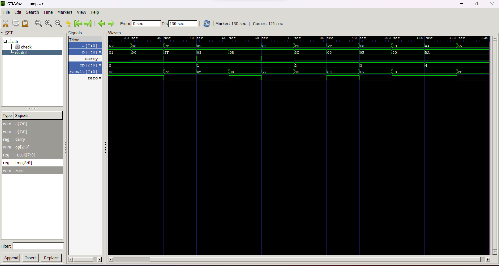

# 8-bit ALU (Verilog)

Combinational 8-bit ALU with ADD, SUB, AND, OR, XOR, plus carry and zero flags.

## Operations

| op  | Operation |
|-----|-----------|
| 000 | ADD |
| 001 | SUB |
| 010 | AND |
| 011 | OR  |
| 100 | XOR |

## Run

```
iverilog -o alu_sim src/alu.v tb/alu_tb.v
vvp alu_sim
gtkwave dump.vcd
```

## Verification

Self-checking testbench covering normal and boundary cases (255+1, 0+0, 3-5, equal operands). Result: 13 PASS, 0 FAIL.

## Waveform



## Tools

Verilog, Icarus Verilog, GTKWave
